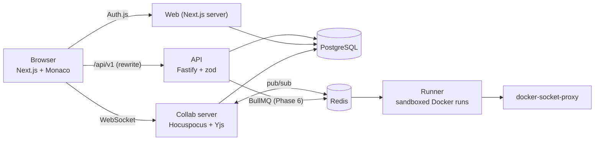

# CollabCode

A browser-based collaborative code editor for small teams. Open a shared project, edit
together in real time, run the code, and always see **who wrote what**, like Google Docs,
but for code, and without depending on anyone's machine being online.

> **Status: Phase 3 of 7 (sharing).** Sign-in, projects, file tree, dashboard, live multi-user
> editing with named cursors and presence, persistence, and share links with **guest access,
> invite-only approval, expiry and viewer / commenter / editor roles**. Authorship tracking,
> review tools (comments, suggestions, checkpoints), code execution and export arrive in later
> phases. Sections marked *(planned)* describe the target design.

## Architecture



| Path | What it is | Status |
|---|---|---|
| `apps/web` | Next.js (App Router) + Tailwind UI, Auth.js sign-in, Monaco editor | Phase 1-2 |
| `apps/api` | Fastify REST API: projects, files, share links, collab tokens, permissions | Phase 1-2 |
| `apps/collab` | Hocuspocus (Yjs) WebSocket server: auth, persistence, Redis sync | Phase 2 |
| `apps/runner` | BullMQ worker running code in locked-down containers | placeholder |
| `packages/shared` | zod schemas, types, permission matrix, palette | Phase 1 |
| `packages/db` | Prisma schema, migrations, seed script | Phase 1 |

## Running it

### Option A: Docker Compose

```bash
cp .env.example .env        # optional; defaults work for the demo login
docker compose up --build
```

Open <http://localhost:3000>. Use **Sign in as alice / bob** (development login, seeded demo
users). Compose starts Postgres and Redis, applies migrations, seeds the demo data, then
starts the services (web :3000, api :4000, collab :1234). The browser must be able to reach
port 1234 (the collab WebSocket); change `COLLAB_PUBLIC_URL` if you expose it elsewhere.

### Try the collaboration flow (about 2 minutes)

1. **Alice:** open <http://localhost:3000>, click *Sign in as alice*, create a project (any
   language). The default file opens in the editor and the status shows **Live**.
2. Click **Share project** (top of the sidebar). Pick what people can do (*edit / comment / view
   only*), how long the link lasts (*1 hour / 1 day / 7 days / never*), optionally tick *Require my
   approval to join*, then **Create link** and **Copy link**.
3. **A guest (no account):** open a *private/incognito window* and paste the link. Type a display
   name and click *Continue as guest*. You are in the project, marked **guest**, and Alice sees you
   in *Online now* and as a labelled cursor (e.g. "GG Gina Guest (guest)").
4. **Bob (has an account):** in another private window paste the link and choose *Sign in
   instead*, then *Sign in as bob*. You land in the project with the link's role.
5. Type in the windows: text appears live everywhere. With a *view only* or *comment* link the
   editor says *Read-only* and typing does nothing.
6. **Invite-only:** create a link with *Require my approval to join*. Whoever opens it (guest or
   account) sees "Waiting for approval". Alice's *Share project* button shows a badge ("1 waiting");
   open it and **Approve** or **Reject**. The waiting person is let in (or told no) within a few
   seconds.
7. **Expiry:** an expired link shows "This link has expired" instead of a name form. (To try it
   without waiting, create a 1-hour link and move its `expiresAt` into the past in the database.)
8. Stop and restart the stack (`docker compose restart collab`): reopen the file and the text is
   still there. Edits made while briefly offline (e.g. pause the network in dev tools) merge when
   the connection returns.

### Option B: local development

Requires Node 22+, pnpm 10 and a PostgreSQL 16 database.

```bash
pnpm install
cp .env.example .env                       # set DATABASE_URL to your database
export $(grep -v '^#' .env | xargs)        # or use your shell's dotenv tooling
pnpm db:generate
pnpm --filter @collabcode/db exec prisma migrate deploy
pnpm db:seed
pnpm --filter @collabcode/collab start &   # ws://localhost:1234  (needs COLLAB_JWT_SECRET, REDIS_URL optional)
pnpm --filter @collabcode/api start &      # http://localhost:4000
pnpm --filter @collabcode/web dev          # http://localhost:3000
```

### Real sign-in with Google / GitHub

Create OAuth apps and set `AUTH_GOOGLE_ID/SECRET` and/or `AUTH_GITHUB_ID/SECRET` in `.env`.
Callback URLs: `http://localhost:3000/api/auth/callback/google` and `.../github`.
Set `AUTH_SECRET` to a random value (`openssl rand -base64 32`). Set `DEV_LOGIN=false` to hide
the demo login.

## Tests and checks

```bash
pnpm lint
pnpm typecheck
pnpm test                       # unit tests; API integration tests need DATABASE_URL + migrations
pnpm --filter @collabcode/web e2e    # Playwright; needs a migrated + seeded DB and DEV_LOGIN=true;
                                     # it starts collab, api and web itself if they aren't running
```

CI (`.github/workflows/ci.yml`) runs lint, type-check and tests against a Postgres service on every push.

## Environment variables

| Variable | Used by | Purpose |
|---|---|---|
| `DATABASE_URL` | api, web, db | PostgreSQL connection string |
| `REDIS_URL` | collab, runner (later) | Redis connection string. When set, collab instances share documents and presence through Redis pub/sub, so you can run several. Optional for a single instance |
| `COLLAB_JWT_SECRET` | api, collab | Shared secret (min. 32 chars) that signs/verifies the short-lived collab tokens. Both services refuse to start without it |
| `COLLAB_PUBLIC_URL` | api | Collab WebSocket URL as the browser reaches it (default `ws://localhost:1234`) |
| `WEB_ORIGIN` | api | Origin of the web app; writes from other origins are rejected (CSRF check) |
| `API_URL` | web | Where the web server (and the `/api/v1` rewrite) reaches the API |
| `API_PORT` | api | API listen port (default 4000) |
| `PORT` | collab | Collab listen port (default 1234) |
| `TRUST_PROXY_HOPS` | api | Number of reverse proxies in front of the API (default 0). Compose sets `1` because the browser reaches the API through the web app's `/api/v1` proxy; the API then uses the client address that proxy appended to `X-Forwarded-For` and ignores anything the client wrote there. Keep the API port unpublished in production |
| `AUTH_SECRET`, `AUTH_URL` | web | Auth.js secret and public URL |
| `AUTH_GOOGLE_ID/SECRET`, `AUTH_GITHUB_ID/SECRET` | web | OAuth credentials; a provider is shown only when configured |
| `DEV_LOGIN` | web | `true` enables passwordless login as seeded demo users. **Never in production** (also hard-disabled when `NODE_ENV=production`) |

Secrets live in environment variables only; `.env` is git-ignored.

## Key design decisions (so far)

- **One permission matrix, enforced server-side.** `packages/shared/src/permissions.ts` maps
  role → allowed actions and is used by every API route (and, from Phase 2, by the collab
  server). Roles are always read from the database, never from the client. Non-members get a
  404 (not 403) so project existence isn't leaked. Deny-by-default.
- **Shared zod schemas.** Request validation lives in `packages/shared`, so the frontend and
  backend can't drift apart; all inputs are validated before touching the database.
- **Auth.js database sessions.** The session cookie is an opaque token that the API looks up in
  the `Session` table, so the API and web app share one login without sharing JWT secrets.
- **Same-origin API calls.** The browser calls `/api/v1/*`, which Next.js proxies to the API:
  cookies stay same-site, no CORS. As defence in depth, the API also rejects writes whose
  `Origin` header isn't the web app.
- **Soft-deleted files.** Deleting a file hides it but keeps the row so history, blame and
  replay (later phases) still work. Sibling-name uniqueness is a partial unique index, which
  also lets a deleted name be reused.
- **Author colours** come from a colour-blind-safe palette (Okabe-Ito + Tol), and the UI always
  pairs colour with initials or a name.

### Real-time collaboration (Phase 2)

- **Why CRDTs (Yjs).** Every file is a Yjs document. Concurrent edits from any number of people
  merge deterministically without a central lock, and edits made while offline simply merge when
  the client reconnects. The server is just another peer that also stores the document, so a
  project can be reopened when nobody is online. (OT would need the server to order every edit
  and is harder to make correct for offline work.)
- **Hocuspocus** is the Yjs WebSocket server. One room per file (`file:<id>`) plus one
  awareness-only room per project (`presence:<id>`) that powers the *Online now* list across files.
- **Who may connect is decided by the server, from the database.** The API gives a signed-in
  member a 10-minute JWT that proves *identity only*. On every connection the collab server
  verifies it, looks up the member's role in Postgres and makes viewers/commenters
  **read-only on the server**: their document updates are dropped, not just hidden in the UI.
  Unknown files, deleted files and non-members all get the same refusal, so ids can't be probed.
  A role change in the database takes effect on the next (re)connect.
- **Cursors can't be spoofed.** Awareness is client-supplied, so the server rewrites it before
  broadcasting: the displayed name, initials and colour always come from the database,
  unknown fields are dropped and sizes are capped. Labels show *initials and name*, never
  colour alone, and are rendered through a CSS builder that rejects anything but `#rrggbb`
  colours and escapes names.
- **Persistence.** Hocuspocus debounces writes and stores the whole document as one compacted
  snapshot per file (`DocSnapshot`); it is reloaded when the file is next opened. (The
  per-edit event log for authorship arrives in Phase 4.)
- **Horizontal scaling.** With `REDIS_URL` set, the Hocuspocus Redis extension syncs document
  updates and awareness between instances; an integration test runs two collab servers against
  one Redis.
- **Editor assets.** Monaco is copied into `apps/web/public/monaco` at dev/build time and served
  from our own origin (no CDN), so the editor works offline and in Docker. y-monaco is pointed
  at that already-loaded instance instead of bundling a second copy.

### Share links, guests and approval (Phase 3)

- **Links.** The owner creates a link with a role (*viewer*, *commenter* or *editor*, never
  owner), a lifetime (*1 hour*, *1 day*, *7 days*, *never*) and optionally "require approval". The
  secret is 256 random bits and **only its SHA-256 hash is stored**, so the full URL is shown once,
  at creation. Revoking stops the link and declines its pending requests; people who already
  joined keep access.
- **Guests (no account).** Opening a link without an account asks for a display name only. The
  server validates the link *before* creating anything, then creates a guest user (no email) and a
  30-day session cookie; only a hash of the cookie secret is stored. A guest gets exactly the
  link's role, can open the shared project(s) but **cannot create projects**, and is marked
  **guest** in the header, the presence list and on their cursor, so nobody can pass as a
  signed-in teammate by choosing a familiar name. Names are limited to 40 characters with control,
  bidirectional-override and zero-width characters rejected. Each project accepts at most 50 guests.
- **Invite-only.** Joining records one pending request and grants nothing. The owner sees pending
  requests (with who is asking, whether they are a guest, and the role they'd get) and approves or
  rejects them; the member always gets the **link's** role, never anything the requester sent. The
  waiting visitor's page re-checks every few seconds. A rejected person cannot simply ask again;
  revoking the link declines everything pending; a link accepts at most 50 pending requests.
- **Expiry.** Computed from the *server's* clock when the link is created and checked on every use.
  An expired link answers `410` with a specific message ("This link has expired"), whereas
  unknown and revoked links look identical (`404`). Expiry stops *new* joins; existing members keep
  access.
- **Commenter.** Gets read access now (the collab server makes the connection read-only) and will
  be able to comment once Phase 5 adds comments.
- **Edits are blocked on the server, not in the UI.** The collab server decides read-only from the
  database role on every connection and refuses document updates from viewers and commenters,
  including guests holding those roles. Tests drive the WebSocket with hand-built protocol frames
  (so no client library is involved) and also tamper with the page to unlock Monaco: the edit stays
  on the attacker's own screen, is never broadcast and never stored. A positive control proves
  those same frames *are* accepted from an editor.
- **Rate limits** are per signed-in/guest session, or per client address for anonymous calls (the
  guest-join endpoint allows 60/min per address so a classroom can join together; the link
  preview is limited per link because the web server makes that call on visitors' behalf).

### Known limitations

- The file tree is not live: other people's new/renamed files appear after a reload.
- Owners cannot yet remove members or change their roles, and revoking a link does not remove
  people who already joined. Expiry likewise only stops new joins.
- Expired guest sessions and guests who were rejected are not yet cleaned up from the database.
- Pending requests are discovered by polling (every 3-5 s), not pushed.
- A guest holding an *editor* link can edit (guests get "the link's role"). If you'd rather cap
  guests at commenter, that is a one-line change in `services/share-links.ts`.
- Rate limit counters are in memory (per API instance); they move to Redis in Phase 6.
- Documents have no size cap yet (frames are capped at 5 MB).

*(planned)* How authorship tracking works and how the code sandbox is secured will be documented
here as those phases land.
