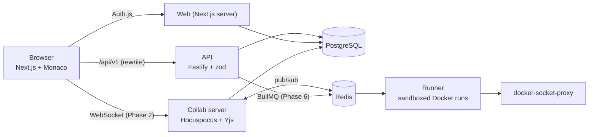

# CollabCode

A browser-based collaborative code editor for small teams. Open a shared project, edit
together in real time, run the code, and always see **who wrote what**, like Google Docs,
but for code, and without depending on anyone's machine being online.

> **Status: Phase 1 of 7 (foundation).** Sign-in, projects, file tree and dashboard are
> working. Real-time editing, sharing, authorship tracking, review tools, code execution and
> export arrive in later phases. Sections marked *(planned)* describe the target design.

## Architecture



| Path | What it is | Status |
|---|---|---|
| `apps/web` | Next.js (App Router) + Tailwind UI, Auth.js sign-in | Phase 1 |
| `apps/api` | Fastify REST API: projects, files, permissions | Phase 1 |
| `apps/collab` | Hocuspocus (Yjs) WebSocket server | placeholder |
| `apps/runner` | BullMQ worker running code in locked-down containers | placeholder |
| `packages/shared` | zod schemas, types, permission matrix, palette | Phase 1 |
| `packages/db` | Prisma schema, migrations, seed script | Phase 1 |

## Running it

### Option A: Docker Compose

```bash
cp .env.example .env        # optional; defaults work for the demo login
docker compose up --build
```

Open <http://localhost:3000>. Use **Sign in as alice / bob** (development login, seeded demo
users). Compose starts Postgres and Redis, applies migrations, seeds the demo data, then
starts the services.

### Option B: local development

Requires Node 22+, pnpm 10 and a PostgreSQL 16 database.

```bash
pnpm install
cp .env.example .env                       # set DATABASE_URL to your database
export $(grep -v '^#' .env | xargs)        # or use your shell's dotenv tooling
pnpm db:generate
pnpm --filter @collabcode/db exec prisma migrate deploy
pnpm db:seed
pnpm --filter @collabcode/api start &      # http://localhost:4000
pnpm --filter @collabcode/web dev          # http://localhost:3000
```

### Real sign-in with Google / GitHub

Create OAuth apps and set `AUTH_GOOGLE_ID/SECRET` and/or `AUTH_GITHUB_ID/SECRET` in `.env`.
Callback URLs: `http://localhost:3000/api/auth/callback/google` and `.../github`.
Set `AUTH_SECRET` to a random value (`openssl rand -base64 32`). Set `DEV_LOGIN=false` to hide
the demo login.

## Tests and checks

```bash
pnpm lint
pnpm typecheck
pnpm test                       # unit tests; API integration tests need DATABASE_URL + migrations
cd apps/web && npx playwright test   # e2e; needs seeded DB and DEV_LOGIN=true (starts api + web itself)
```

CI (`.github/workflows/ci.yml`) runs lint, type-check and tests against a Postgres service on every push.

## Environment variables

| Variable | Used by | Purpose |
|---|---|---|
| `DATABASE_URL` | api, web, db | PostgreSQL connection string |
| `REDIS_URL` | collab, runner (later) | Redis connection string |
| `WEB_ORIGIN` | api | Origin of the web app; writes from other origins are rejected (CSRF check) |
| `API_URL` | web | Where the web server (and the `/api/v1` rewrite) reaches the API |
| `API_PORT` | api | API listen port (default 4000) |
| `AUTH_SECRET`, `AUTH_URL` | web | Auth.js secret and public URL |
| `AUTH_GOOGLE_ID/SECRET`, `AUTH_GITHUB_ID/SECRET` | web | OAuth credentials; a provider is shown only when configured |
| `DEV_LOGIN` | web | `true` enables passwordless login as seeded demo users. **Never in production** (also hard-disabled when `NODE_ENV=production`) |

Secrets live in environment variables only; `.env` is git-ignored.

## Key design decisions (so far)

- **One permission matrix, enforced server-side.** `packages/shared/src/permissions.ts` maps
  role → allowed actions and is used by every API route (and, from Phase 2, by the collab
  server). Roles are always read from the database, never from the client. Non-members get a
  404 (not 403) so project existence isn't leaked. Deny-by-default.
- **Shared zod schemas.** Request validation lives in `packages/shared`, so the frontend and
  backend can't drift apart; all inputs are validated before touching the database.
- **Auth.js database sessions.** The session cookie is an opaque token that the API looks up in
  the `Session` table, so the API and web app share one login without sharing JWT secrets.
- **Same-origin API calls.** The browser calls `/api/v1/*`, which Next.js proxies to the API:
  cookies stay same-site, no CORS. As defence in depth, the API also rejects writes whose
  `Origin` header isn't the web app.
- **Soft-deleted files.** Deleting a file hides it but keeps the row so history, blame and
  replay (later phases) still work. Sibling-name uniqueness is a partial unique index, which
  also lets a deleted name be reused.
- **Author colours** come from a colour-blind-safe palette (Okabe-Ito + Tol), and the UI always
  pairs colour with initials or a name.

*(planned)* Why CRDTs, how authorship tracking works and how the code sandbox is secured will be
documented here as those phases land.
