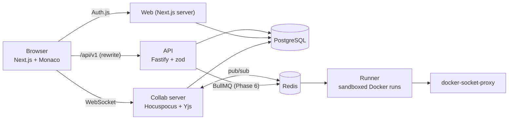

# CollabCode

A browser-based collaborative code editor for small teams. Open a shared project, edit
together in real time, run the code, and always see **who wrote what**, like Google Docs,
but for code, and without depending on anyone's machine being online.

> **Status: Phase 2 of 7 (real-time collaboration).** Sign-in, projects, file tree, dashboard,
> live multi-user editing with named cursors and presence, persistence, and basic share links
> (viewer / editor, revocable) work. Guest access, invite-only approval, link expiry,
> authorship tracking, review tools, code execution and export arrive in later phases.
> Sections marked *(planned)* describe the target design.

## Architecture



| Path | What it is | Status |
|---|---|---|
| `apps/web` | Next.js (App Router) + Tailwind UI, Auth.js sign-in, Monaco editor | Phase 1-2 |
| `apps/api` | Fastify REST API: projects, files, share links, collab tokens, permissions | Phase 1-2 |
| `apps/collab` | Hocuspocus (Yjs) WebSocket server: auth, persistence, Redis sync | Phase 2 |
| `apps/runner` | BullMQ worker running code in locked-down containers | placeholder |
| `packages/shared` | zod schemas, types, permission matrix, palette | Phase 1 |
| `packages/db` | Prisma schema, migrations, seed script | Phase 1 |

## Running it

### Option A: Docker Compose

```bash
cp .env.example .env        # optional; defaults work for the demo login
docker compose up --build
```

Open <http://localhost:3000>. Use **Sign in as alice / bob** (development login, seeded demo
users). Compose starts Postgres and Redis, applies migrations, seeds the demo data, then
starts the services (web :3000, api :4000, collab :1234). The browser must be able to reach
port 1234 (the collab WebSocket); change `COLLAB_PUBLIC_URL` if you expose it elsewhere.

### Try the collaboration flow (about 2 minutes)

1. **Alice:** open <http://localhost:3000>, click *Sign in as alice*, create a project
   (any language). The default file opens in the editor and the status shows **Live**.
2. Click **Share** in the sidebar, choose *edit*, **Create link**, then **Copy link**.
3. **Bob:** open a *private/incognito window* (separate cookies), paste the link. You are sent to
   sign in; click *Sign in as bob* and you land in Alice's project as an *editor*.
4. Type in both windows: text appears live in the other window, each person's cursor carries a
   label such as "AD Alice Demo", and the sidebar's *Online now* list shows both people and the
   file each is viewing.
5. In Alice's window create a second link with *view only*, revoke the first, and open the viewer
   link as a different user (or Bob in another project): the editor shows *Read-only (viewer)*
   and typing does nothing. Revoked links show "invalid or has been revoked".
6. Stop and restart the stack (`docker compose restart collab`): reopen the file and the
   text is still there. Edits made while briefly offline (e.g. pause the network in dev tools)
   merge when the connection returns.

### Option B: local development

Requires Node 22+, pnpm 10 and a PostgreSQL 16 database.

```bash
pnpm install
cp .env.example .env                       # set DATABASE_URL to your database
export $(grep -v '^#' .env | xargs)        # or use your shell's dotenv tooling
pnpm db:generate
pnpm --filter @collabcode/db exec prisma migrate deploy
pnpm db:seed
pnpm --filter @collabcode/collab start &   # ws://localhost:1234  (needs COLLAB_JWT_SECRET, REDIS_URL optional)
pnpm --filter @collabcode/api start &      # http://localhost:4000
pnpm --filter @collabcode/web dev          # http://localhost:3000
```

### Real sign-in with Google / GitHub

Create OAuth apps and set `AUTH_GOOGLE_ID/SECRET` and/or `AUTH_GITHUB_ID/SECRET` in `.env`.
Callback URLs: `http://localhost:3000/api/auth/callback/google` and `.../github`.
Set `AUTH_SECRET` to a random value (`openssl rand -base64 32`). Set `DEV_LOGIN=false` to hide
the demo login.

## Tests and checks

```bash
pnpm lint
pnpm typecheck
pnpm test                       # unit tests; API integration tests need DATABASE_URL + migrations
pnpm --filter @collabcode/web e2e    # Playwright; needs a migrated + seeded DB and DEV_LOGIN=true;
                                     # it starts collab, api and web itself if they aren't running
```

CI (`.github/workflows/ci.yml`) runs lint, type-check and tests against a Postgres service on every push.

## Environment variables

| Variable | Used by | Purpose |
|---|---|---|
| `DATABASE_URL` | api, web, db | PostgreSQL connection string |
| `REDIS_URL` | collab, runner (later) | Redis connection string. When set, collab instances share documents and presence through Redis pub/sub, so you can run several. Optional for a single instance |
| `COLLAB_JWT_SECRET` | api, collab | Shared secret (min. 32 chars) that signs/verifies the short-lived collab tokens. Both services refuse to start without it |
| `COLLAB_PUBLIC_URL` | api | Collab WebSocket URL as the browser reaches it (default `ws://localhost:1234`) |
| `WEB_ORIGIN` | api | Origin of the web app; writes from other origins are rejected (CSRF check) |
| `API_URL` | web | Where the web server (and the `/api/v1` rewrite) reaches the API |
| `API_PORT` | api | API listen port (default 4000) |
| `PORT` | collab | Collab listen port (default 1234) |
| `AUTH_SECRET`, `AUTH_URL` | web | Auth.js secret and public URL |
| `AUTH_GOOGLE_ID/SECRET`, `AUTH_GITHUB_ID/SECRET` | web | OAuth credentials; a provider is shown only when configured |
| `DEV_LOGIN` | web | `true` enables passwordless login as seeded demo users. **Never in production** (also hard-disabled when `NODE_ENV=production`) |

Secrets live in environment variables only; `.env` is git-ignored.

## Key design decisions (so far)

- **One permission matrix, enforced server-side.** `packages/shared/src/permissions.ts` maps
  role → allowed actions and is used by every API route (and, from Phase 2, by the collab
  server). Roles are always read from the database, never from the client. Non-members get a
  404 (not 403) so project existence isn't leaked. Deny-by-default.
- **Shared zod schemas.** Request validation lives in `packages/shared`, so the frontend and
  backend can't drift apart; all inputs are validated before touching the database.
- **Auth.js database sessions.** The session cookie is an opaque token that the API looks up in
  the `Session` table, so the API and web app share one login without sharing JWT secrets.
- **Same-origin API calls.** The browser calls `/api/v1/*`, which Next.js proxies to the API:
  cookies stay same-site, no CORS. As defence in depth, the API also rejects writes whose
  `Origin` header isn't the web app.
- **Soft-deleted files.** Deleting a file hides it but keeps the row so history, blame and
  replay (later phases) still work. Sibling-name uniqueness is a partial unique index, which
  also lets a deleted name be reused.
- **Author colours** come from a colour-blind-safe palette (Okabe-Ito + Tol), and the UI always
  pairs colour with initials or a name.

### Real-time collaboration (Phase 2)

- **Why CRDTs (Yjs).** Every file is a Yjs document. Concurrent edits from any number of people
  merge deterministically without a central lock, and edits made while offline simply merge when
  the client reconnects. The server is just another peer that also stores the document, so a
  project can be reopened when nobody is online. (OT would need the server to order every edit
  and is harder to make correct for offline work.)
- **Hocuspocus** is the Yjs WebSocket server. One room per file (`file:<id>`) plus one
  awareness-only room per project (`presence:<id>`) that powers the *Online now* list across files.
- **Who may connect is decided by the server, from the database.** The API gives a signed-in
  member a 10-minute JWT that proves *identity only*. On every connection the collab server
  verifies it, looks up the member's role in Postgres and makes viewers/commenters
  **read-only on the server**: their document updates are dropped, not just hidden in the UI.
  Unknown files, deleted files and non-members all get the same refusal, so ids can't be probed.
  A role change in the database takes effect on the next (re)connect.
- **Cursors can't be spoofed.** Awareness is client-supplied, so the server rewrites it before
  broadcasting: the displayed name, initials and colour always come from the database,
  unknown fields are dropped and sizes are capped. Labels show *initials and name*, never
  colour alone, and are rendered through a CSS builder that rejects anything but `#rrggbb`
  colours and escapes names.
- **Persistence.** Hocuspocus debounces writes and stores the whole document as one compacted
  snapshot per file (`DocSnapshot`); it is reloaded when the file is next opened. (The
  per-edit event log for authorship arrives in Phase 4.)
- **Horizontal scaling.** With `REDIS_URL` set, the Hocuspocus Redis extension syncs document
  updates and awareness between instances; an integration test runs two collab servers against
  one Redis.
- **Editor assets.** Monaco is copied into `apps/web/public/monaco` at dev/build time and served
  from our own origin (no CDN), so the editor works offline and in Docker. y-monaco is pointed
  at that already-loaded instance instead of bundling a second copy.

### Share links (Phase 2: basic version)

- The owner creates a link with a role (*viewer* or *editor*). The link's secret is 256 random
  bits; **only its SHA-256 hash is stored**, so a database leak doesn't leak working links. The
  full URL is therefore shown once, at creation.
- Opening `/join/<token>` while signed in adds you to the project with the link's role. Signed
  out, you're sent to sign in and straight back (only same-site return paths are accepted).
  Joining never changes an existing member's role (no accidental upgrade or downgrade).
- Revoking stops the link working; people who already joined keep their access (removing members
  comes later). Unknown, revoked and expired links give the same answer.
- The `/join/*` pages send `Referrer-Policy: no-referrer` and `no-store` so the token doesn't leak.
- Rate limits are counted **per signed-in user**, not per IP, so a team sharing one network
  doesn't throttle itself.

### Known limitations in this phase

- The file tree is not live: other people's new/renamed files appear after a reload.
- Removing a member (and kicking them from an open session) isn't built; revoking a link doesn't
  remove existing members.
- Rate limit counters are in memory (per API instance); they move to Redis in Phase 6.
- Documents have no size cap yet (frames are capped at 5 MB).

*(planned)* How authorship tracking works and how the code sandbox is secured will be documented
here as those phases land.
