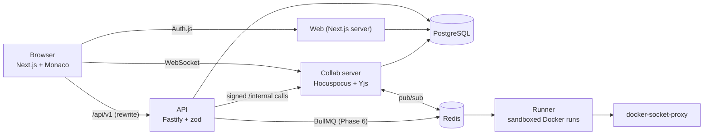

# CollabCode

A browser-based collaborative code editor for small teams. Open a shared project, edit
together in real time, run the code, and always see **who wrote what**, like Google Docs,
but for code, and without depending on anyone's machine being online.

> **Status: Phase 5 of 7 (review tools).** Sign-in, projects, file tree, live multi-user
> editing with named cursors, share links with guests / approval / expiry / roles, **who wrote
> what** (blame, contribution colours, per-person history, contribution timeline), and now
> **review tools**: suggestions that editors accept or reject, inline comment threads, named
> checkpoints with restore, and session replay. Code execution and export arrive in later phases.
> Sections marked *(planned)* describe the target design.

## Architecture



| Path | What it is | Status |
|---|---|---|
| `apps/web` | Next.js (App Router) + Tailwind UI, Auth.js sign-in, Monaco editor | Phase 1-2 |
| `apps/api` | Fastify REST API: projects, files, share links, collab tokens, permissions, suggestions, comments, checkpoints, replay data | Phase 1-5 |
| `apps/collab` | Hocuspocus (Yjs) WebSocket server: auth, persistence, Redis sync, authorship, signed `/internal` edit endpoints | Phase 2-5 |
| `apps/runner` | BullMQ worker running code in locked-down containers | placeholder |
| `packages/shared` | zod schemas, types, permission matrix, palette | Phase 1 |
| `packages/db` | Prisma schema, migrations, seed script | Phase 1 |

## Running it

### Option A: Docker Compose

```bash
cp .env.example .env        # optional; defaults work for the demo login
docker compose up --build
```

Open <http://localhost:3000>. Use **Sign in as alice / bob** (development login, seeded demo
users). Compose starts Postgres and Redis, applies migrations, seeds the demo data, then
starts the services (web :3000, api :4000, collab :1234). The browser must be able to reach
port 1234 (the collab WebSocket); change `COLLAB_PUBLIC_URL` if you expose it elsewhere.

### Try the collaboration flow (about 2 minutes)

1. **Alice:** open <http://localhost:3000>, click *Sign in as alice*, create a project (any
   language). The default file opens in the editor and the status shows **Live**.
2. Click **Share project** (top of the sidebar). Pick what people can do (*edit / comment / view
   only*), how long the link lasts (*1 hour / 1 day / 7 days / never*), optionally tick *Require my
   approval to join*, then **Create link** and **Copy link**.
3. **A guest (no account):** open a *private/incognito window* and paste the link. Type a display
   name and click *Continue as guest*. You are in the project, marked **guest**, and Alice sees you
   in *Online now* and as a labelled cursor (e.g. "GG Gina Guest (guest)").
4. **Bob (has an account):** in another private window paste the link and choose *Sign in
   instead*, then *Sign in as bob*. You land in the project with the link's role.
5. Type in the windows: text appears live everywhere. With a *view only* or *comment* link the
   editor says *Read-only* and typing does nothing.
6. **Invite-only:** create a link with *Require my approval to join*. Whoever opens it (guest or
   account) sees "Waiting for approval". Alice's *Share project* button shows a badge ("1 waiting");
   open it and **Approve** or **Reject**. The waiting person is let in (or told no) within a few
   seconds.
7. **Expiry:** an expired link shows "This link has expired" instead of a name form. (To try it
   without waiting, create a 1-hour link and move its `expiresAt` into the past in the database.)
8. **Who wrote what (Phase 4).** Have Alice and Bob each type on a different line. Hover over a
   line: a card says who wrote it and when ("and 1 other" if two people wrote on the same line).
   Press **Contribution colours** to tint each person's text, with their initials in the gutter and
   a legend. Open the **History** tab, choose a person and a time range, and press *Show what
   ... changed* for a diff of exactly their additions and removals. Open **Contributions** for a
   timeline lane per person plus lines added/removed, active time and "lines still theirs".
9. **Suggestions and comments (Phase 5).** Make a link with the *comment* role and open it as Bob.
   Bob cannot type, but can select text and press **Suggest change** (type the replacement) or
   **Comment** in the Review sidebar. Alice sees the suggestion highlighted in the text and in her
   sidebar (within ~3 s) and presses **Accept** (the text changes for everyone; open **History**: the
   change is credited to *Bob*, tagged "accepted suggestion") or **Reject**. On the **Comments** tab
   Alice replies to Bob's thread and presses **Resolve**; Bob sees both. Add lines above the
   commented text: the thread and any open suggestion stay on their text.
10. **Checkpoints and replay (Phase 5).** Open the **Checkpoints** tab, name a checkpoint, then
   break the file. Press **Restore project** (owner only) and confirm: the file is back, the History
   tab shows "Alice restored checkpoint “...” (whole project)" with an **Undo this restore** button
   (press it and the exact previous content returns). Press Restore again: "Already at this
   checkpoint". Open **Replay**: press play, change the speed, drag the slider, pick a
   person under *Step through changes by*, or *Start from* a checkpoint.
11. Stop and restart the stack (`docker compose restart collab`): reopen the file and the text is
   still there. Edits made while briefly offline (e.g. pause the network in dev tools) merge when
   the connection returns. Hover again: the authors are the same.

### Option B: local development

Requires Node 22+, pnpm 10 and a PostgreSQL 16 database.

```bash
pnpm install
cp .env.example .env                       # set DATABASE_URL to your database
export $(grep -v '^#' .env | xargs)        # or use your shell's dotenv tooling
pnpm db:generate
pnpm --filter @collabcode/db exec prisma migrate deploy
pnpm db:seed
pnpm --filter @collabcode/collab start &   # ws://localhost:1234  (needs COLLAB_JWT_SECRET, REDIS_URL optional)
pnpm --filter @collabcode/api start &      # http://localhost:4000
pnpm --filter @collabcode/web dev          # http://localhost:3000
```

### Real sign-in with Google / GitHub

Create OAuth apps and set `AUTH_GOOGLE_ID/SECRET` and/or `AUTH_GITHUB_ID/SECRET` in `.env`.
Callback URLs: `http://localhost:3000/api/auth/callback/google` and `.../github`.
Set `AUTH_SECRET` to a random value (`openssl rand -base64 32`). Set `DEV_LOGIN=false` to hide
the demo login.

## Tests and checks

```bash
pnpm lint
pnpm typecheck
pnpm test                       # unit tests; API integration tests need DATABASE_URL + migrations
pnpm --filter @collabcode/web e2e    # Playwright; needs a migrated + seeded DB and DEV_LOGIN=true;
                                     # it starts collab, api and web itself if they aren't running
```

CI (`.github/workflows/ci.yml`) runs lint, type-check and tests against a Postgres service on every push.

## Environment variables

| Variable | Used by | Purpose |
|---|---|---|
| `DATABASE_URL` | api, web, db | PostgreSQL connection string |
| `REDIS_URL` | collab, runner (later) | Redis connection string. When set, collab instances share documents and presence through Redis pub/sub, so you can run several. Optional for a single instance |
| `COLLAB_JWT_SECRET` | api, collab | Shared secret (min. 32 chars) that signs/verifies the short-lived collab tokens. Both services refuse to start without it |
| `COLLAB_PUBLIC_URL` | api | Collab WebSocket URL as the browser reaches it (default `ws://localhost:1234`) |
| `COLLAB_INTERNAL_URL` | api | Collab server as the API reaches it, server to server (default `http://localhost:1234`; compose sets `http://collab:1234`). Used for the signed `/internal` calls behind accepting suggestions, checkpoints and restore |
| `WEB_ORIGIN` | api | Origin of the web app; writes from other origins are rejected (CSRF check) |
| `API_URL` | web | Where the web server (and the `/api/v1` rewrite) reaches the API |
| `API_PORT` | api | API listen port (default 4000) |
| `PORT` | collab | Collab listen port (default 1234) |
| `TRUST_PROXY_HOPS` | api | Number of reverse proxies in front of the API (default 0). Compose sets `1` because the browser reaches the API through the web app's `/api/v1` proxy; the API then uses the client address that proxy appended to `X-Forwarded-For` and ignores anything the client wrote there. Keep the API port unpublished in production |
| `AUTH_SECRET`, `AUTH_URL` | web | Auth.js secret and public URL |
| `AUTH_GOOGLE_ID/SECRET`, `AUTH_GITHUB_ID/SECRET` | web | OAuth credentials; a provider is shown only when configured |
| `DEV_LOGIN` | web | `true` enables passwordless login as seeded demo users. **Never in production** (also hard-disabled when `NODE_ENV=production`) |

Secrets live in environment variables only; `.env` is git-ignored.

## Key design decisions (so far)

- **One permission matrix, enforced server-side.** `packages/shared/src/permissions.ts` maps
  role → allowed actions and is used by every API route (and, from Phase 2, by the collab
  server). Roles are always read from the database, never from the client. Non-members get a
  404 (not 403) so project existence isn't leaked. Deny-by-default.
- **Shared zod schemas.** Request validation lives in `packages/shared`, so the frontend and
  backend can't drift apart; all inputs are validated before touching the database.
- **Auth.js database sessions.** The session cookie is an opaque token that the API looks up in
  the `Session` table, so the API and web app share one login without sharing JWT secrets.
- **Same-origin API calls.** The browser calls `/api/v1/*`, which Next.js proxies to the API:
  cookies stay same-site, no CORS. As defence in depth, the API also rejects writes whose
  `Origin` header isn't the web app.
- **Soft-deleted files.** Deleting a file hides it but keeps the row so history, blame and
  replay (later phases) still work. Sibling-name uniqueness is a partial unique index, which
  also lets a deleted name be reused.
- **Author colours** come from a colour-blind-safe palette (Okabe-Ito + Tol), and the UI always
  pairs colour with initials or a name.

### Real-time collaboration (Phase 2)

- **Why CRDTs (Yjs).** Every file is a Yjs document. Concurrent edits from any number of people
  merge deterministically without a central lock, and edits made while offline simply merge when
  the client reconnects. The server is just another peer that also stores the document, so a
  project can be reopened when nobody is online. (OT would need the server to order every edit
  and is harder to make correct for offline work.)
- **Hocuspocus** is the Yjs WebSocket server. One room per file (`file:<id>`) plus one
  awareness-only room per project (`presence:<id>`) that powers the *Online now* list across files.
- **Who may connect is decided by the server, from the database.** The API gives a signed-in
  member a 10-minute JWT that proves *identity only*. On every connection the collab server
  verifies it, looks up the member's role in Postgres and makes viewers/commenters
  **read-only on the server**: their document updates are dropped, not just hidden in the UI.
  Unknown files, deleted files and non-members all get the same refusal, so ids can't be probed.
  A role change in the database takes effect on the next (re)connect.
- **Cursors can't be spoofed.** Awareness is client-supplied, so the server rewrites it before
  broadcasting: the displayed name, initials and colour always come from the database,
  unknown fields are dropped and sizes are capped. Labels show *initials and name*, never
  colour alone, and are rendered through a CSS builder that rejects anything but `#rrggbb`
  colours and escapes names.
- **Persistence.** Hocuspocus debounces writes and stores the whole document as one compacted
  snapshot per file (`DocSnapshot`); it is reloaded when the file is next opened. (The
  per-edit event log for authorship arrives in Phase 4.)
- **Horizontal scaling.** With `REDIS_URL` set, the Hocuspocus Redis extension syncs document
  updates and awareness between instances; an integration test runs two collab servers against
  one Redis.
- **Editor assets.** Monaco is copied into `apps/web/public/monaco` at dev/build time and served
  from our own origin (no CDN), so the editor works offline and in Docker. y-monaco is pointed
  at that already-loaded instance instead of bundling a second copy.

### Share links, guests and approval (Phase 3)

- **Links.** The owner creates a link with a role (*viewer*, *commenter* or *editor*, never
  owner), a lifetime (*1 hour*, *1 day*, *7 days*, *never*) and optionally "require approval". The
  secret is 256 random bits and **only its SHA-256 hash is stored**, so the full URL is shown once,
  at creation. Revoking stops the link and declines its pending requests; people who already
  joined keep access.
- **Guests (no account).** Opening a link without an account asks for a display name only. The
  server validates the link *before* creating anything, then creates a guest user (no email) and a
  30-day session cookie; only a hash of the cookie secret is stored. A guest gets exactly the
  link's role, can open the shared project(s) but **cannot create projects**, and is marked
  **guest** in the header, the presence list and on their cursor, so nobody can pass as a
  signed-in teammate by choosing a familiar name. Names are limited to 40 characters with control,
  bidirectional-override and zero-width characters rejected. Each project accepts at most 50 guests.
- **Invite-only.** Joining records one pending request and grants nothing. The owner sees pending
  requests (with who is asking, whether they are a guest, and the role they'd get) and approves or
  rejects them; the member always gets the **link's** role, never anything the requester sent. The
  waiting visitor's page re-checks every few seconds. A rejected person cannot simply ask again;
  revoking the link declines everything pending; a link accepts at most 50 pending requests.
- **Expiry.** Computed from the *server's* clock when the link is created and checked on every use.
  An expired link answers `410` with a specific message ("This link has expired"), whereas
  unknown and revoked links look identical (`404`). Expiry stops *new* joins; existing members keep
  access.
- **Commenter.** Gets read access now (the collab server makes the connection read-only) and will
  be able to comment once Phase 5 adds comments.
- **Edits are blocked on the server, not in the UI.** The collab server decides read-only from the
  database role on every connection and refuses document updates from viewers and commenters,
  including guests holding those roles. Tests drive the WebSocket with hand-built protocol frames
  (so no client library is involved) and also tamper with the page to unlock Monaco: the edit stays
  on the attacker's own screen, is never broadcast and never stored. A positive control proves
  those same frames *are* accepted from an editor.
- **Rate limits** are per signed-in/guest session, or per client address for anonymous calls (the
  guest-join endpoint allows 60/min per address so a classroom can join together; the link
  preview is limited per link because the web server makes that call on visitors' behalf).

### Authorship design (Phase 4)

**What is recorded.** Every character in a Yjs document lives in an *item* with a permanent id
`(clientID, clock)`. Typing in a row is one item, a paste is one item, so the data grows with how
often authorship *changes*, not with characters. Authorship is the mapping "item id range ->
authenticated user + server time". It is stored in the `DocEvent` table, one row per **batch** of
changes by one user (the row also holds the merged Yjs update, so the log can rebuild the file,
and counts of characters and newlines added/removed). It is never stored inside the document, where
a client could forge it. The user is always the verified identity of the WebSocket connection (the
Hocuspocus context loaded from the database), never anything in the update.

**Attribution happens at delivery, not by diffing the document.** The server decodes each incoming
update *before applying it* and credits the id ranges that are new to the server. The obvious
alternative, "see which ids appeared in this transaction", is wrong. Yjs holds back an update whose
dependencies have not arrived (pending structs). If Alice's update arrives before the update it
builds on, Yjs applies it later, in the transaction triggered by *whoever delivered the missing
piece*, and a transaction diff credits Alice's text to that person. A unit test reproduces it
(`authorship.test.ts`, "attribution at delivery, not by diffing the transaction"): the transaction
that delivers update 1 contains all 6 clocks, including the 3 that update 2 delivered earlier. Deleted text is measured in the same pre-apply step, because by the time Yjs emits its
`update` event it has already garbage-collected the deleted content.

**ClientID ownership.** The first authenticated user whose connection uses a clientID owns it; the
claim is persisted (`YClient`, first writer wins, so it also holds across server instances and
restarts). A clientID is claimed by an awareness (cursor) update or by delivering new items. An
awareness update that claims someone else's clientID is rejected (the connection to that document is
closed with Hocuspocus close reason `Forbidden`, code 4403, and the attempt is logged).

*Recovery rule (changed in Phase 5).* New items under a clientID owned by **someone else** are no
longer rejected. The first version of this rule closed the connection, but after a crash that is the
wrong outcome: the owner's unflushed events are gone, other people's browsers still hold the owner's
text and re-send it when they reconnect, and those innocent users were disconnected until the author
came back. Now the update is accepted and applied, the new range is credited to the **owner of the
clientID (from the persisted claim)**, never to whoever delivered it, and the event is flagged
`recovered` and logged. The UI says so: the blame hover shows "attributed after recovery" and the
history timeline shows an "attributed after recovery" badge. Deletions in that same update are still
credited to the person who sent it. Re-sending items already on record is unchanged (not new, never
re-attributed). Tests: `tracker.test.ts` (crash recovery with a fresh tracker over the persisted
claim), `authorship.integration.test.ts` (over real WebSockets, including a simulated crash where the
last events and snapshot are deleted and Bob re-syncs).

*The trade-off, stated plainly.* The old rule also stopped a deliberate attack: pre-sending text
under another user's clientID. With the recovery rule that text is accepted, and credited to the
clientID's owner (flagged `recovered`, so it is visible and logged, but it is not credited to the
attacker). It can also "squat" the id, so the owner's browser, on seeing foreign items under its own
id, switches to a fresh clientID (Yjs does this itself) and carries on; whatever it had typed at the
exact colliding clocks is the one thing that can be lost. Only people who can already edit the file
can do this, and the evidence stays in the log, but the attribution of such text should be read as
"recovered", not as proof. We chose this over disconnecting people, because the alternative punishes
users who did nothing wrong.

**Batching.** Keystrokes are merged in memory per (file, user, clientID) and written after 1.5 s of
quiet or at most every 5 s, when someone disconnects, on shutdown, and **before every document
snapshot** (the authorship extension has a higher hook priority than the database extension, so a
saved snapshot never contains text whose attribution exists only in memory). Typing 60 characters
is one or two rows. Trade-offs: other people's fresh text shows up in your blame view after their
batch is saved plus your next poll (up to about 5 s + 3 s; your own typing is attributed
instantly); a hard crash can lose up to the last few seconds of attribution (see below); the log
grows with activity and is not compacted yet.

**Blame is computed in the browser** by walking the live text's items and joining them with the
attribution ranges (fetched once, then incrementally "after event N"). Each line shows its main
author (most non-whitespace characters) and "and N others". Hovering is free and always matches the
screen. Text with no record (written before Phase 4) is shown as *unknown author*, never guessed.

**History and the diff.** The timeline pages through `DocEvent` rows. The per-person diff replays
the file's events from the beginning onto a document that keeps deleted text, ordered by when each
batch started, and reports exactly what the person inserted and removed with line numbers. Replay is
capped at 20,000 events (a clear error asks for an earlier end date). The session-replay player
(Phase 5) does not have this problem because it can start from a checkpoint; the per-person diff still
replays from the beginning.

**Contribution summary.** "Lines" means newline characters typed or removed (so it adds up across
batches). Active time sums a person's working sessions, bridging gaps under 5 minutes. People are
listed in order of first activity, never ranked. "Lines still theirs" comes from the last saved
snapshot of each file.

### Known limitations (authorship)

- **Undo / restore credit.** Undo and redo re-insert text as new items, so restored text is credited
  to *whoever pressed undo*, even when it was originally someone else's. The same rule applies to
  deleting and retyping. Giving restored text back to its original author would need Yjs's own undo
  manager, which y-monaco does not use.
- **Times are server receive times.** Text typed offline shows the time it synced, because client
  clocks cannot be trusted.
- **Crash window.** A hard crash can lose up to ~5 s of buffered attribution. If other users' clients
  then re-send that text, it is accepted and credited to its owner, flagged "attributed after
  recovery" (see the recovery rule above), but the original timestamps are gone: it shows the time of
  the re-send. Graceful shutdowns flush everything.
- **ClientID collisions** (two users randomly picking the same 32-bit id, about 1 in 4 billion per
  pair) would credit the second user's text to the first, flagged as recovered.
- **The per-person history diff** replays from the start (20,000-event cap) and orders batches by start time, so under
  heavy concurrent editing the line numbers are "as of replay" and approximate.
- The event log is append-only with no retention or compaction yet; "lines still theirs" skips
  files over 2 MB and looks at the first 100 files.
- Several collab servers share ownership through the database, but each keeps its own in-memory
  "already recorded" ranges (loaded when it opens a file), so a very rare cross-server race is
  resolved by the database claim.

### Review tools (Phase 5)

**Suggestions are an overlay, not text in the document.** A suggestion is a row (author, the
anchored range, the text it replaces, the replacement) shown on top of the editor: the range is
highlighted with a dashed underline and a tag naming the author ("✎ BD suggests"), hovering shows
the change, and the Suggestions tab of the Review sidebar lists them with old and new text. The file
only changes when an editor or the owner accepts one. Commenters can suggest (they select text, press
**Suggest change**, type the replacement) but can never edit directly; viewers can read them.
Selecting nothing and suggesting inserts at the cursor. Editors can also suggest.

*Accepting is a normal edit credited to the suggester.* The API asks the collab server (a signed
`/internal/edit` call) to apply the replacement to the live document. The server builds the edit on a
scratch copy under a fresh clientID, runs it through the same authorship path as a typed edit
(`tracker.onDelivery`, before applying), and broadcasts it. So the history shows it as the
**suggester's** change (event origin `suggestion-accept`, badge "accepted suggestion"), not the
accepter's. It appears live for everyone connected. **Nobody approves their own suggestion**
(enforced on the server: 403 `SELF_ACCEPT`, even for the owner); the author can only withdraw it, and
any *other* editor or the owner can accept or reject. The sidebar says whose code a suggestion changes
("Alice suggested a change to Bob's code", from the same attribution data as blame) and highlights
suggestions on **your** code with an "On your code" badge. Rejecting changes nothing; the author can
withdraw their own. Claiming is atomic (`UPDATE ... WHERE status = 'OPEN'`), so two editors clicking
Accept cannot apply it twice; if the call to the collab server fails, the suggestion goes back to open.

**Anchors are Yjs RelativePositions, never line/column.** `packages/shared/src/review/anchors.ts`.
A relative position names the *character* (its immutable item id) the position sits next to, so it
follows that character through concurrent edits. The start is attached to the first character of the
range and the end to the last one: text typed right before or after stays outside, text typed inside
stretches the range, deleting part of it shrinks it, and deleting all of it makes a suggestion
**stale** (out of date; it cannot be applied and says so) while a comment thread keeps its stored
quote. A selection of nothing (an insertion point) uses one position for both ends. Anchors are
stored as opaque bytes and resolved against the live document, by the collab server when it matters
(accept, create) and by each browser for drawing. Unit tests make a range, edit above, before, after
and inside it concurrently from another peer, and check it still names the same text. If the text
inside a suggestion's range changed after it was made, the sidebar warns "The text has changed since
this was suggested" and accepting replaces whatever is in the range now.

**Inline comments.** Select text (or put the cursor on a line) and press **Comment**. Threads are
anchored the same way, shown with a yellow dotted underline and a 💬 count, listed in the Comments
tab with their replies, newest state first. Everyone who can comment can reply (commenters included).
Resolve/Reopen is for editors and the owner, and for the person who started the thread. Resolved
threads move under "Show resolved". Clicking a thread or suggestion selects its text in the editor.
Comments are plain text, rendered as text (never HTML), capped at 4,000 characters, 200 per thread,
500 threads per file. Suggestions and comments refresh by polling every 2.5 s.

**Checkpoints.** The Checkpoints tab creates a named snapshot of every file (editors and the owner).
The API first reads each file's last event id, then asks the collab server to flush (event buffers and
the document snapshot are written to the database immediately, so text typed a moment ago is
included), then copies the snapshots. A checkpoint may contain a few events newer than its recorded
event id; replaying them on top later is harmless because applying a Yjs update twice changes
nothing. **Restore** (owner only, as the permission matrix already said) works on the whole project or
on the open file, behind an explicit confirmation. A restore:
  1. first checks whether anything would change. If the current content (and, for the whole project,
     the set of files) already matches the target, **nothing happens**: no edit, no automatic save, no
     history entry, and the UI says "Already at this checkpoint";
  2. otherwise takes a hidden **automatic save** of the whole project (see below);
  3. sets each file's text to the checkpoint's with the *smallest single replacement* (common start
     and end untouched), applied by the collab server as an edit **credited to the restorer** with
     event origin `restore`, so it is in the history and in blame like any other change;
  4. for the whole project, brings back files that were deleted since (renaming to `name (restored)`
     on a clash) and removes (soft-deletes, so history keeps working) files created since;
  5. records the restore (`CheckpointRestore`: who, which checkpoint, whole project or which file,
     and the id of the automatic save).

*Automatic saves are hidden plumbing.* The Checkpoints list and replay's "Start from" show only
checkpoints a person named. Automatic saves are ordinary checkpoint rows flagged `automatic`; their
name is fixed text plus a timestamp (`auto-save before restore · 2026-...Z`), never built from any
other checkpoint's name, so names cannot nest ("Before restoring Before restoring ..."). The API
treats them as nonexistent (404 for listing details, restoring, or replaying from them). They are
never pruned, and there is no cap on named checkpoints either; they cost storage (see limitations).

*History and undo.* The History tab has a **Restores** section: "Alice restored checkpoint
“introduction” (whole project / main.py) · time". **Undo this restore** (owner only) restores the
hidden automatic save taken just before that restore, with the same scope. Undoing is itself a restore:
it gets its own history entry ("undid the restore of checkpoint ...", credited to whoever pressed it),
its own hidden automatic save, and its own Undo button (so you can redo). A restore can be undone
once. If the content already matches the automatic save, undo says "Already at that content" and
changes nothing.
Folder renames and moves are not reverted (restore works per file id).

**Session replay.** The Replay tab plays a file's history from the event log: play/pause, speed
(0.5x to 16x), a scrubber (a native slider, keyboard operable, with "Change N of M"), previous/next,
and a **Step through changes by** filter. The filter selects whose changes are the steps; everyone
else's changes are still applied silently, because Yjs updates depend on each other and dropping some
would corrupt the text, so the text shown is always correct. "Start from" offers the beginning and
every checkpoint containing the file, with the number of changes to load from each. Starting from a
checkpoint loads the checkpoint's snapshot plus only the events after its recorded event id, so long
histories no longer have to be replayed from the beginning (the picker defaults to the latest
checkpoint when the file has more than 2,000 changes, and a request over 20,000 changes is refused
with a hint to pick a later checkpoint). The player keeps a keyframe every 100 events so scrubbing
backwards does not start over. The delay between two changes is their real gap squeezed into
0.15-1.5 s, divided by the speed.

**Who is acting (identity).** The author of every comment, reply, suggestion, resolve and accept comes
only from the session cookie on the server (`ctx.user`), never from the request body or the project
owner. One pitfall is the browser, not the server: the session is a single cookie per browser, so
signing in as Alice in a second tab of the same browser replaces Bob's cookie, and Bob's already-open
tab (its WebSocket was authenticated earlier) keeps showing Bob while its REST calls go out as Alice.
To prevent that silently happening, every call from a project page carries `X-Expected-User`; the
server answers **409 `IDENTITY_CHANGED`** when the cookie belongs to someone else, and the page also
re-checks `/me` on focus, visibility change and every 30 s and shows a "You are now signed in as X"
banner with a Reload button. Use separate browser profiles or private windows for two people.

**Security notes.** `suggestion:create` / `comment:create` come from the role in the database for
every request (never the client); non-members get 404 and viewers 403. The collab server's
`/internal` endpoints are called only by the API and require an HMAC of `timestamp.body` made with the
shared `COLLAB_JWT_SECRET` (60 s window, constant-time compare); they are on the same port as the
WebSocket, so **do not expose `/internal` through your reverse proxy** (only `/` WebSocket and
`/health` need to be public). Request bodies are validated with zod and capped.

### Known limitations (review tools)

- **No type-to-suggest mode.** Suggestions are made from a selection and a replacement box, not by
  typing "as a suggestion" directly in the text.
- **Polling, not push.** Other people's suggestions, comments and checkpoints show up within about
  2.5 s (the replay and checkpoint tabs load when opened).
- **Accept replaces what is in the range now.** If the text changed since the suggestion was made, you
  are warned, not blocked. A suggestion that covered only text that has since been deleted is stale.
- **Comments cannot be edited or deleted** yet, and there is no @-mentioning or notifications.
- **Restore is owner-only** (the permission matrix since Phase 1); editors can create checkpoints.
  Folder structure changes (renames, moves) are not reverted by a restore, and a whole-project
  restore removes files created since the checkpoint (undoable with *Undo this restore*).
- **Checkpoints store full snapshots** of every file each time (no deduplication). Named checkpoints
  are unlimited and automatic saves (one per restore or undo that changed something) are never
  pruned, so a long-lived project with many restores uses real space. Undo goes back to the
  automatic save: it restores file contents, deletions and creations, but not folder renames or moves.
- **Replay** shows text only (no syntax colouring), steps through *saved* events (the last few seconds
  of typing appear after the 1.5-5 s batch is written, or immediately when a checkpoint is made), and
  shows at most 4,000 lines.
- Server edits go to whichever collab instance receives the API call; other instances pick the change
  up through Redis like any other update. A multi-instance deployment should route `/internal` to one
  instance or any instance (both work), but `/internal/flush` only flushes the instance it reaches.

### Known limitations

- The file tree is not live: other people's new/renamed files appear after a reload.
- Owners cannot yet remove members or change their roles, and revoking a link does not remove
  people who already joined. Expiry likewise only stops new joins.
- Expired guest sessions and guests who were rejected are not yet cleaned up from the database.
- Pending requests are discovered by polling (every 3-5 s), not pushed.
- A guest holding an *editor* link can edit (guests get "the link's role"). If you'd rather cap
  guests at commenter, that is a one-line change in `services/share-links.ts`.
- Rate limit counters are in memory (per API instance); they move to Redis in Phase 6.
- Documents have no size cap yet (frames are capped at 5 MB).

*(planned)* How authorship tracking works and how the code sandbox is secured will be documented
here as those phases land.
